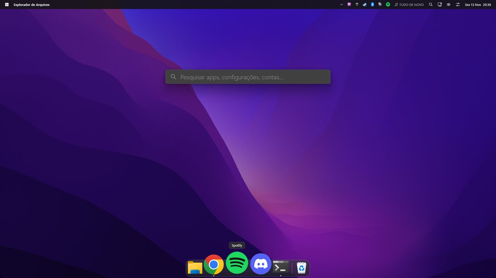

# Doca

Dock e barra de menu estilo macOS para Windows 11, em .NET 10 / WPF.



## Instalar / atualizar

```powershell
.\install.ps1             # publica em %LOCALAPPDATA%\Programs\Doca, cria atalho no Menu Iniciar e inicia
.\install.ps1 -Startup    # idem + iniciar com o Windows
.\install.ps1 -Uninstall  # remove (preferências ficam em %APPDATA%\Doca)
```

A cópia instalada é separada da pasta do código: dá para compilar e testar sem fechar o Doca em uso.

## Desenvolver

```powershell
dotnet build -c Release
.\bin\Release\net10.0-windows\Doca.exe --preview   # não mexe na taskbar
```

Linha de comando: `--quit` fecha a instância aberta (restaurando tudo), `--settings` abre as Preferências, `--spotlight` abre o Spotlight, `--preview` testa sem esconder a taskbar.

Antes de publicar uma mudança grande, passe pela [lista de testes](TESTES.md).

## Recursos

- **Dock** (uma por tela): ampliação, esconder automaticamente, badges de notificação, barra de progresso (downloads, cópias), pré-visualização de janelas, arrastar para reordenar/fixar/remover, lixeira. Botão direito como no Mac (janelas, Opções, Ocultar, Encerrar/Forçar com Shift ou Alt) e com a **Jump List** do app (recentes, fixados, tarefas como "Nova janela anônima").
- **Barra de menu** (uma por tela): menus do app em foco, ícones da bandeja (inclusive os escondidos), painéis próprios de calendário, som (volume e saída), Wi-Fi e Bluetooth.
- **Central de Controle**: Wi-Fi, Bluetooth, modo escuro, projetar, brilho de cada monitor (DDC/CI), volume e música.
- **Música tocando** na barra (Spotify, YouTube…) com capa, tempo e controles.
- **Spotlight** (Alt+Espaço ou a lupa da barra): apps, páginas de Configurações, ações do sistema, contas rápidas e busca na web/arquivos.
- Some só na tela que tem um app em tela cheia; cantos arredondados; Alt+` alterna janelas do mesmo app.
- Tudo configurável em **Preferências** (logo da barra → Preferências do Doca…).

## Recuperação automática

O Doca inicia um processo vigia (`Doca.exe --watchdog <pid>`, sem interface). Se o Doca terminar sem passar pela saída normal:

| Como terminou | O vigia |
|---|---|
| Travamento | libera o espaço das barras, restaura a taskbar e reabre o Doca (até 3 vezes em 2 minutos) |
| "Finalizar tarefa" no Gerenciador | libera o espaço e restaura a taskbar, sem reabrir |

Ocorrências ficam em `%APPDATA%\Doca\log.txt`.

## Arquitetura

| Arquivo | Responsabilidade |
|---|---|
| `DockWindow.cs` | Dock: layout, animação (vsync, só quando algo se move), entrada, arrastar |
| `MenuBarWindow.cs` | Barra de menu e itens de status |
| `BarFx.cs` | Destaque animado dos itens da barra, ícones monocromáticos da bandeja, equalizador da música |
| `Island.cs` | Ilha dinâmica: entalhe no topo (relógio, música, avisos de volume, brilho, fones, Caps Lock) e o painel com abas |
| `IslandWidgets.cs` | Aba Início da ilha: grade de widgets (música, calendário, sistema, timer, downloads, copiados) e o monitor de CPU/memória/disco/rede |
| `Peripherals.cs` | Bateria do mouse Rapoo e do headset MCHOSE V9 PRO (receptores 2.4 GHz, protocolos HID dos fabricantes) |
| `IslandExtras.cs` | Extras da ilha: prateleira de arquivos, histórico do que foi copiado, câmera/microfone em uso, downloads e timer |
| `Flyouts.cs` | Painéis de calendário, som, Wi-Fi e Bluetooth |
| `ControlCenter.cs` | Central de Controle, brilho por DDC/CI (`DdcMonitor`), modo escuro (`Theme`) |
| `Media.cs` | Música tocando (`NowPlaying`, API de mídia do Windows) e o player dos painéis |
| `Spotlight.cs` | Busca do Alt+Espaço (apps do Menu Iniciar, Configurações, contas) |
| `AppMenus.cs` | Menus do app (Win32, UI Automation ou menus padrão) |
| `JumpList.cs`, `LoginItems.cs` | Jump Lists dos apps no botão direito da Dock; "Abrir ao Iniciar Sessão" |
| `WindowTracker.cs` | Janelas abertas e tela cheia por monitor (WinEvent hooks) |
| `Tray.cs` | Bandeja do sistema (ManagedShell) e badges |
| `Preview.cs`, `Corners.cs`, `Hotkeys.cs` | Miniaturas DWM, cantos arredondados, Alt+` |
| `Audio.cs`, `Wlan.cs`, `Bluetooth.cs` | Core Audio, Wi-Fi nativo, rádios e dispositivos Bluetooth |
| `AppBar.cs`, `Watchdog.cs`, `Program.cs` | Reserva de espaço, taskbar, recuperação |
